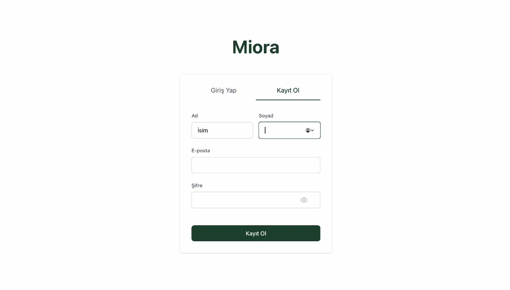
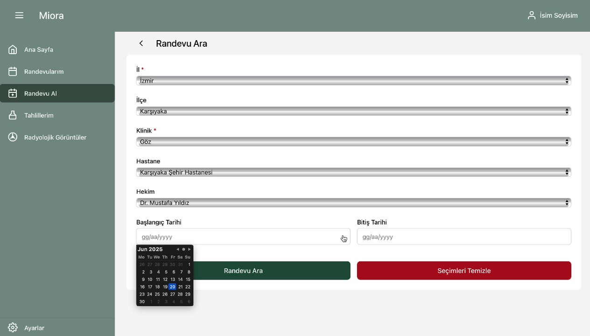
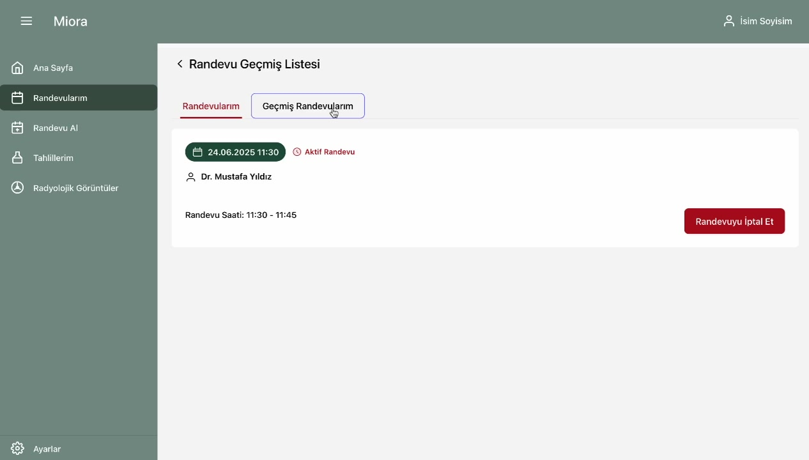
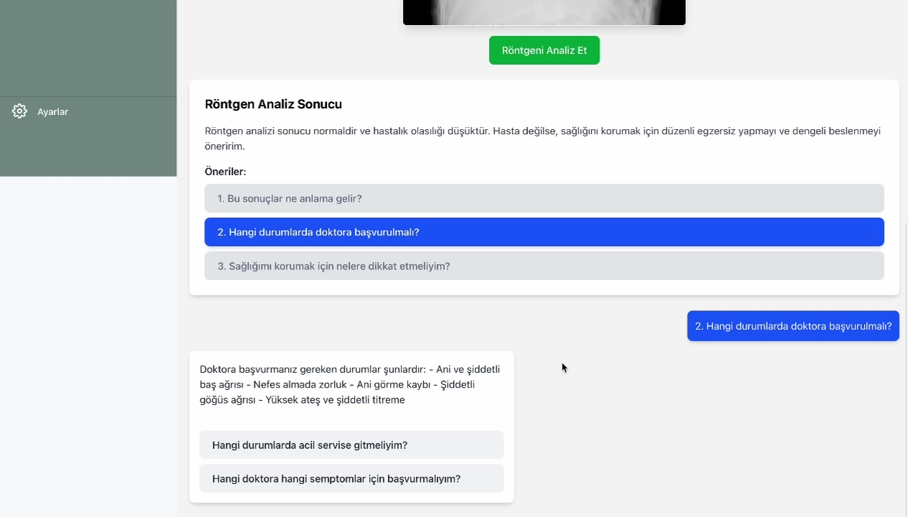
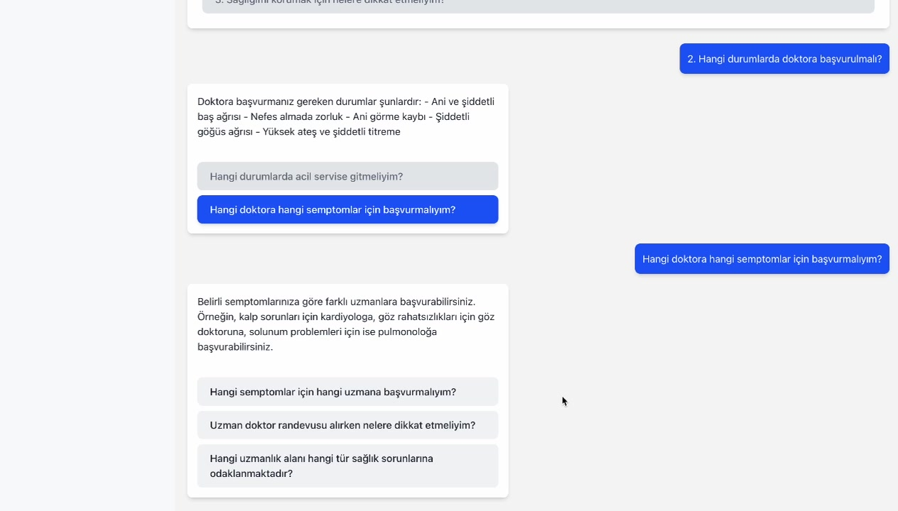

# MIORA AI Services

The AI part of **MIORA**, a team graduation project that combines online doctor appointments with AI-assisted analysis of chest X-rays and blood test PDFs. This repository contains the two Python (Flask) services and the model training notebooks that I developed.

> The rest of the system is a team effort and lives in separate repositories:
> - Backend (ASP.NET Core Web API): [furkanakarcesme/MioraV1](https://github.com/furkanakarcesme/MioraV1)
> - Frontend (React): [zulalhorata/bitirme_v2](https://github.com/zulalhorata/bitirme_v2)

The work is described in the IEEE UBMK 2025 paper
[*AI-Assisted Medical Image Analysis and Healthcare System Integration*](https://ieeexplore.ieee.org/document/11207027) (DOI: 10.1109/UBMK67458.2025.11207027).

> **Disclaimer:** MIORA is a student project. It is not a medical device and must not be used for diagnosis or treatment decisions.

## Screenshots of the full application

The screenshots show the complete application, which is a team work. The AI results shown on screens 4 and 5 come from the services in this repository.

| Register | Find an appointment |
| --- | --- |
|  |  |

| My appointments | X-ray result |
| --- | --- |
|  |  |

| AI follow-up chat |
| --- |
|  |

## How the services fit in

```
React frontend ──► ASP.NET Core Web API ──► SQL Server
                          │
                          ├──► xray-service  :5002   chest X-ray model (Xception)
                          ├──► lab-service   :5001   PDF extraction + diabetes model
                          └──► OpenAI API            explanations and chat
```

The ASP.NET Core backend sends the uploaded image or PDF to these services over REST, then explains the result to the patient in plain Turkish with the OpenAI API.

## What is in this repository

```
xray-service/   Flask service and training notebook for the pneumonia model
lab-service/    Flask service, PDF value extraction and diabetes model
docs/           screenshots
```

### AI models

| Task | Model | Data | Result |
| --- | --- | --- | --- |
| Pneumonia from chest X-ray | Xception (ImageNet weights), fine-tuned: last 30 layers unfrozen, low learning rate, augmentation for the NORMAL class, dropout | Project dataset prepared by me (see paper) | 93% accuracy |
| Diabetes from lab values | Random Forest on glucose and HbA1c | 20,628 records, 80/20 stratified split | 98.6% accuracy on the test split |

Notes:

- **Diabetes data:** the dataset was taken from Kaggle and filtered and reorganized by me, so it differs from the original. The labels follow clear glucose and HbA1c thresholds, so the high accuracy mostly shows that the model learned those thresholds. It is not a clinical result. The notebook prints the test metrics.
- **X-ray result:** the 93% was measured on the project's own dataset and is reported in the paper. That dataset is not part of this repository.
- **Released model:** the `xception_model_finetuned.h5` file in the Releases section is the model used in the MIORA application and in the paper (93% accuracy on the project dataset). The notebook in this repository applies the same approach (two-stage transfer learning and fine-tuning) to the public Kaggle dataset, so re-running it produces a comparable but not identical model.
- The notebook in `xray-service/` uses the public Kaggle *Chest X-Ray Images (Pneumonia)* dataset, so its numbers are not directly comparable. On that dataset's separate test folder (624 images) it reaches 78.9% accuracy with 99.5% recall for pneumonia and 44.4% recall for NORMAL: it rarely misses pneumonia but often flags healthy X-rays. This is a student project and not suitable for real screening.
- The X-ray notebook is based on a public Kaggle notebook; the source note at its top lists what I changed and added.

## Getting started

Prerequisites: Python 3.10 or newer.

**Lab service** (PDF extraction and diabetes model, port 5001):

```bash
cd lab-service
pip install -r requirements.txt
python app.py
```

`POST /analyze-pdf` takes a PDF in the form field `file` and a form field `type`:
- `type=labs` returns the extracted lab values (12 values: glucose, HbA1c, cholesterol, triglyceride, HDL, LDL, CRP, calcium, potassium, creatinine, sodium, urea).
- `type=diabetes` returns the model prediction (`0` or `1`) based on glucose and HbA1c.

The extraction rules are written for Turkish lab reports. `model.pkl` was saved with scikit-learn; if loading fails on a different version, run `diabetes_model.ipynb` to train and save it again.

**X-ray service** (port 5002):

1. Download `xception_model_finetuned.h5` (about 161 MB) from the [v1.0 release](https://github.com/yigitedar/miora-ai-services/releases/tag/v1.0) ([direct download](https://github.com/yigitedar/miora-ai-services/releases/download/v1.0/xception_model_finetuned.h5)) and put it in `xray-service/`, or set the `MODEL_PATH` environment variable.
2. Run:

```bash
cd xray-service
pip install -r requirements.txt
python app.py
```

`POST /predict` takes an image in the form field `file` and returns `result` (`Pneumonia` or `Normal`) and the model score in `HastalikOrani`.

Both services are meant for local use. Set `FLASK_DEBUG=1` to enable Flask debug mode.

## My contribution

- Trained the diabetes classification model and wrote the service that extracts lab values from PDFs.
- Fine-tuned the Xception model for pneumonia detection and wrote the X-ray service.
- Supported a teammate on the .NET backend: the appointment flow, integration of the AI services and the chat module.

## Known limitations

- No automated tests yet.
- No Docker setup yet.
- The X-ray model is weak on healthy images (see the notes above).
- The regular-expression PDF extraction depends on the report layout.

## Authors

Paper authors: Y. Edar, F. Akarçeşme, H. Özcan, Ş. Z. Horata, N. Gözüaçık.
